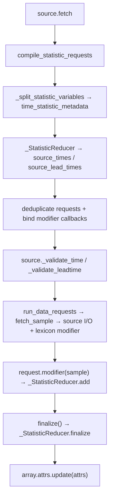

# Earth2Studio Time Statistics

Declare temporal quantities in variable labels, and have data sources produce
them. Native data sources own temporal aggregation; `fetch_data` forwards supported
labels, preserves their metadata, and offers generic reduction with explicit `delta_t`.

## Declarations and Ownership

Qualified variable labels identify temporal quantities unambiguously:

```python
variables = ["u10m", "t2m:mean:1day", "t2m:mean:1week", "t2m:max:30days"]
```

The first `:` separates the source name from its modifier; base names cannot
contain `:`. Raw backend identifiers containing `::` are passed through unchanged,
not parsed as statistic labels. Unqualified labels retain their source-defined
meaning (including native accumulation periods). Qualified labels are canonical
for model and output coordinates. Coordinate constructors derive statistics
metadata from these labels; there is no separate `statistics=` declaration.

Data sources own aggregation: they accept qualified labels for the quantities they
support and return them reduced (see Source Responsibilities). `time_statistics`
owns modifier normalization, window planning, metadata, and block reductions.
`earth2studio.data.utils` provides shared request planning and streaming aggregation.

## Windows

For valid time `T`, intervals are half-open:

| Modifier | Selected interval |
| --- | --- |
| `mean:24h` | `[T - 24h, T)` |
| `mean:-12h:+12h` | `[T - 12h, T + 12h)` |

Built-in methods are `mean`, `sum`, `min`, and `max`. Source cadence must divide
the window exactly. Durations are integers with units `ns`, `us`, `ms`,
`s/sec/second`, `m/min/minute`, `h/hr/hour`, `d/day`, or `w/wk/week`;
plural names are accepted. Weeks are seven days. Month and year durations are
unsupported: specify an explicit number of days or hours instead (for example,
`30days`). `M` and `Y` are rejected rather than interpreted as minutes or fixed
calendar approximations; use lowercase `m` for minutes. NumPy month/year timedeltas
are also rejected as source cadences.

### Calendar-Day Means: FuXi-S2S

FuXi-S2S labels days by **starting midnight**, consumes two consecutive daily means,
and predicts the next. All 76 channels declare means with these hourly windows:

| Quantity | Qualified label | Samples relative to day start |
| --- | --- | --- |
| Ordinary fields | `t2m:mean:0h:24h` | 00–23 UTC |
| Hourly precipitation accumulations | `tp:mean:1h:25h` | 01 UTC through next 00 UTC |
| Hourly thermal radiation accumulations | `ttr:mean:1h:25h` | 01 UTC through next 00 UTC |

Only `tp` and `ttr` shift the window because their source timestamps mark interval
ends. `[T + 1h, T + 25h)` includes 24 hourly samples, excluding next-day 01 UTC.
These means retain one-hour accumulation units; multiply predicted `tp` by 24 for
a daily total. Channel order and model-unit conversions are unchanged.

Preserve start-of-day timestamps and one-day lead increments. Substituting
`mean:24h` would select the preceding day. The source must sample hourly; a source
storing these daily means returns them under the same labels without reducing again.

## Source Responsibilities

A source that supports a temporal quantity accepts its qualified label in
`variable`, like any other variable, and:

- returns it under the requested spelling, with its entry recorded in
  `earth2studio_statistics` (see Metadata and Scope);
- anchors windows to valid time for analysis sources, and to each lead time within
  one initialization for forecast sources, never reducing across initializations;
- reduces on its native grid before returning, so wrappers and
  `fetch_data` regrid one reduced field rather than every sample;
- raises, before fetching, for a modifier it does not support, for duplicate
  normalized quantities such as `t2m:mean:24h` and `t2m:mean:1day`, and for a
  window its cadence cannot sample exactly or whose required coordinates fall
  outside the source's availability;
- documents when base fields are already accumulations: reducing stored values
  does not automatically deaccumulate them or integrate a rate over time.

How a quantity is produced is the source's choice. It may read a stored aggregate,
compose native accumulations as `ARCO_ERA5` does for `tp`, or fetch instantaneous
samples at its cadence and reduce them. Sampling cadence is internal to the
source; no public `time_step` property is required.

Document native support in the source class docstring in a `Note` headed
`Temporal statistics:`: methods, label syntax, cadence, window closure, and
accumulation caveats. Capability metadata belongs on the source's lexicon as
`TIME_STATISTICS`, a tuple of supported method names. Sources expose their lexicon
through `lexicon`; they do not expose `time_statistics` or `time_step` attributes.
An absent lexicon declaration means no native support. `fetch_data` discovers
support through the lexicon (and through wrapped/component sources); an explicit
`delta_t` instead requests generic reduction at that cadence.

## Planning and Reduction

Sources that reduce instantaneous samples use the shared primitives:

```python
time_step = np.timedelta64(6, "h")
times = source_times("mean:24h", valid_time, time_step)
leads = source_lead_times("mean:24h", lead_time, time_step)
result = apply_time_statistic(block, "mean:24h", valid_time, time_step)
```

Planning accepts scalar or array targets. Forecast sources retain initialization
time and plan lead times. Planners can produce negative leads; a source must reject
unavailable leads before downloading, rather than switch to an earlier forecast.

`apply_time_statistic` reduces a variable block for one scalar target, excluding
values outside the window and rejecting missing or duplicate required coordinates.
It selects `lead_time` when present, otherwise `time`; callers may override the
dimension. Xarray preserves NumPy, CuPy, or Dask execution without implicit transfers.

### Native source request pipeline

Use these helpers from `earth2studio.data.utils` for regular-cadence sources:

1. Call `compile_statistic_requests(variable, time, delta_t, values, ...)` with
   `supported=self.lexicon.TIME_STATISTICS`. The compiler parses labels, expands
   windows, deduplicates fetches, and binds processing callbacks to output views.
   It rejects malformed labels, unsupported methods, empty base names, and
   duplicate normalized quantities. `verbose=True` logs operations and samples.
2. Analysis output is `(time, variable, ...)`; pass `lead_time=leads` for forecast
   output `(time, lead_time, variable, ...)`. Unpack the returned tuple as
   `requests, attrs, finalize`. The final item is a function; sources do not manage
   reducer state or a plan object.
3. Each `DataRequest` has `time`, `lead_time`, `variable`, and `modifier`.
   Analysis requests use valid times and zero leads; forecasts retain their
   initialization and vary leads. Validate these request coordinates with source
   validators before reading fields, including initialization-time checks.
4. Fetch each request's base variable and apply the existing lexicon conversion.
   Then call `request.modifier(sample)` once. Like a lexicon modifier, this is a
   processing callback; it writes in place instead of returning a field. It copies
   plain values or updates all consuming windows without retaining the sample.
   `run_data_requests(requests, fetch_sample, ...)` supplies bounded async
   execution for this loop; it has no statistic planning logic.
5. Call `finalize()` once after all requests complete to check sample counts and
   divide means by per-cell valid counts. Set `array.attrs.update(attrs)`.
   Requested spelling, order, target coordinates, and spatial geometry are preserved.

Requests are shared by `(base variable, time, lead_time)` within a compilation.
Equal valid times from different forecast initializations remain distinct requests.

The shared call structure is:



ARCO groups all consumers of each Zarr chunk before `run_data_requests →
_read_chunk`, applies their modifiers together, and releases the chunk immediately.
At most four chunk reads run concurrently, including for multi-level windows.
Derived accumulations use `fetch_array` to sum hourly fields incrementally.
WB2 uses `run_data_requests → fetch_array`; GFS and HRRR
use `_fetch_requests` to share GRIB indices and resolve backend records using
the common scheduler. Backend adapters may fetch components for derived variables.

Field memory is bounded by the output, per-cell mean counts, and concurrent
samples (or backend chunks/components), not a stack of every field in a window.
Coordinate plans and consumer indices still grow with the number of requested
samples. Do not retain decoded fields after their consumers have been updated.
The scheduler uses a fixed worker pool rather than one asyncio task per request;
failures, timeouts, and caller cancellation cancel and await outstanding workers.

NaNs are skipped: an all-NaN window yields NaN for mean/min/max and zero for sum.
This is distinct from an absent coordinate or failed download. The scheduler
propagates download failures; sources may explicitly represent missing records
as NaN fields. `finalize` rejects incomplete windows.

### Implemented source capabilities

All sources below declare `("mean", "sum", "min", "max")` on their lexicon.

| Source | Sampling | Window axis |
| --- | --- | --- |
| `ARCO_ERA5` | 1 hour | Valid time |
| `WB2ERA5`, `WB2ERA5_121x240`, `WB2ERA5_32x64` | 6 hours | Valid time |
| `GFS` | 6 hours | Valid time |
| `GFS_FX` | 1 hour | Lead within initialization |
| `HRRR` | 1 hour | Valid time |
| `HRRR_FX` | 1 hour | Lead within initialization |

Source-specific considerations:

- ARCO derived overlapping accumulation periods can double-count totals.
- WB2 overlapping `tp12` / `tp24` samples double-count rainfall.
- GFS raw `tp` uses resetting buckets; analysis `tp06` uses the preceding cycle's
  complete six-hour bucket. Forecast `tp06` requires leads ≥6h; overlapping totals
  must not be interpreted as disjoint rainfall.
- HRRR reductions operate on source-defined stored values.
- All forecast sources require expanded leads to be available for each initialization.

`WB2Climatology` does not declare native statistics. Hourly planning does not
interpolate missing forecast leads; source availability validation remains binding.

Custom block reductions share the window syntax and must preserve non-time
dimensions, including `variable`:

```python
register_time_statistic("range", lambda x, dim: x.max(dim) - x.min(dim))
```

Registration does not enable a method in native streaming sources. Those sources
support only their declared subset of `STREAMING_STATISTICS`. Use explicit
`delta_t` with `fetch_data` for a registered generic reduction.

## Metadata and Scope

`time_statistic_metadata()` returns normalized modifier, method, window, offsets,
and interval closure. Durations remain `np.timedelta64` until serialization.
Native results record qualified labels in `earth2studio_statistics`:

```python
array.attrs["earth2studio_statistics"] = {
    "t2m:mean:1day": time_statistic_metadata("mean:1day")
}
```

Labels carry quantity identity through handshakes; attributes support lookup and
serialization. Record CF-compatible time bounds and `cell_methods` when supported.

Irregular-cadence inference, cross-variable diagnostics, and fused GPU kernels are
out of scope. The current native streaming helpers operate on NumPy fields.

## Verification

Keep one mocked statistics test per source (extend its existing call mock when
present). Mock backend I/O, retaining real parsing, planning, validation, and
aggregation. Cover all four reductions, plain/statistic mixtures, metadata,
overlapping-window fetch sharing, request order, NaNs, and invalid windows.
Forecast cases also cover distinct initializations and unavailable/negative leads.
Shared fixtures live in `test/data/conftest.py`; block-window tests live in
`test/utils/test_time_statistics.py`.
