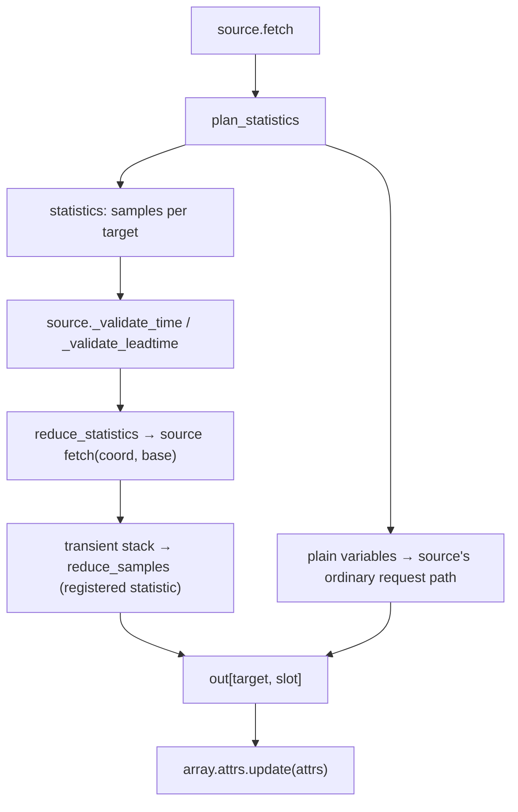

# Earth2Studio Time Statistics

Declare temporal quantities in variable labels, and have data sources produce
them. Native data sources own temporal aggregation; `fetch_data` forwards supported
labels and preserves their metadata. Sampling and reduction belong to the source.

## Declarations and Ownership

Qualified variable labels identify temporal quantities unambiguously:

```python
variables = ["u10m", "t2m:mean:1day", "t2m:mean:1week", "t2m:max:30days"]
```

The first `:` separates the source name from its modifier; base names cannot
contain `:`. Raw backend identifiers containing `::` are passed through unchanged,
not parsed as statistic labels. Unqualified labels retain their source-defined
meaning (including native accumulation periods). Qualified labels are canonical
for model and output coordinates. Coordinate constructors derive statistics
metadata from these labels; there is no separate `statistics=` declaration.

Data sources own aggregation: they accept qualified labels for the quantities they
support and return them reduced (see Source Responsibilities). `time_statistics`
owns modifier normalization, window planning, metadata, and block reductions.
`earth2studio.data.utils` provides shared request planning and window reduction.

## Windows

For valid time `T`, intervals are half-open and **right-closed**: a window ending
at `T` includes the sample stamped `T` and excludes the one stamped at its start.

| Modifier | Selected interval |
| --- | --- |
| `mean:24h` | `(T - 24h, T]` |
| `mean:-12h:+12h` | `(T - 12h, T + 12h]` |

At source cadence `Δ`, a window `(T + start, T + end]` reads the stamps
`T + start + Δ, …, T + end`. The `earth2studio_statistics` metadata records this as
`closed: "right"`.

Built-in methods are `mean`, `sum`, `min`, and `max`, which propagate missing
samples (see Planning and Reduction), and their NaN-skipping counterparts `nanmean`,
`nansum`, `nanmin`, and `nanmax`. Source cadence must divide
the window exactly. Durations are integers with units `ns`, `us`, `ms`,
`s/sec/second`, `m/min/minute`, `h/hr/hour`, `d/day`, or `w/wk/week`;
plural names are accepted. Weeks are seven days. Month and year durations are
unsupported: specify an explicit number of days or hours instead (for example,
`30days`). `M` and `Y` are rejected rather than interpreted as minutes or fixed
calendar approximations; use lowercase `m` for minutes. NumPy month/year timedeltas
are also rejected as source cadences.

### Accumulations and Means of Instantaneous Fields

Accumulations and mean rates are stamped at the **end** of their period: hourly
ARCO-ERA5 `tp`, `ttr`, `ro` and `sf` and HRRR forecast `tp` hold `(t - 1h, t]` at
stamp `t`, and so do 6-hourly model outputs such as `tp06`. Right-closed windows
match this, so a two-part label covers the period ending at `T` at any cadence:

| Label at `T` | Hourly stamps read | Physical period |
| --- | --- | --- |
| `tp:sum:6h` | `T-5h` … `T` | `(T - 6h, T]` |
| `tp06` (ARCO alias) | `T-5h` … `T` | `(T - 6h, T]` |

On 6-hourly `tp06` frames, `tp:sum:24h` reads `T-18h` … `T`, the 24 hours ending at
`T`. For instantaneous fields a window holds the samples after its start up to and
including its end, so `t2m:max:24h` at `T` reads `T-23h` … `T` hourly. Use explicit
offsets when a different set of samples is wanted, as ORBIT-2 does for its daily
extremes (`t2m:max:-25h:-1h` reads `T-24h` … `T-1h`).

Running buckets that reset periodically (GFS `tp`) cannot be summed: the buckets
overlap, so `tp:sum:Nh` double counts; use `tp06`. Each affected source states this
in its `Temporal statistics:` note.

### Calendar-Day Means: FuXi-S2S

FuXi-S2S labels days by **starting midnight**, consumes two consecutive daily means,
and predicts the next. All 76 channels declare means with these hourly windows:

| Quantity | Qualified label | Samples relative to day start |
| --- | --- | --- |
| Ordinary fields | `t2m:mean:-1h:23h` | 00–23 UTC |
| Hourly precipitation accumulations | `tp:mean:0h:24h` | 01 UTC through next 00 UTC |
| Hourly thermal radiation accumulations | `ttr:mean:0h:24h` | 01 UTC through next 00 UTC |

`tp` and `ttr` cover the day itself, `(T, T + 24h]`, because their timestamps mark
interval ends: 24 hourly samples from 01 UTC through next-day 00 UTC. Ordinary
fields take the instantaneous samples 00–23 UTC, `(T - 1h, T + 23h]`.
These means retain one-hour accumulation units; multiply predicted `tp` by 24 for
a daily total. Channel order and model-unit conversions are unchanged.

Preserve start-of-day timestamps and one-day lead increments. Substituting
`mean:24h` would select the preceding day. The source must sample hourly; a source
storing these daily means returns them under the same labels without reducing again.

## Source Responsibilities

A source that supports a temporal quantity accepts its qualified label in
`variable`, like any other variable, and:

- returns it under the requested spelling, with its entry recorded in
  `earth2studio_statistics` (see Metadata and Scope);
- anchors windows to valid time for analysis sources, and to each lead time within
  one initialization for forecast sources, never reducing across initializations;
- reduces on its native grid before returning, so wrappers and
  `fetch_data` regrid one reduced field rather than every sample;
- raises, before fetching, for a modifier it does not support, for duplicate
  normalized quantities such as `t2m:mean:24h` and `t2m:mean:1day`, and for a
  window its cadence cannot sample exactly or whose required coordinates fall
  outside the source's availability;
- documents when base fields are already accumulations: reducing stored values
  does not automatically deaccumulate them or integrate a rate over time.

How a quantity is produced is the source's choice. It may read a stored aggregate,
compose native accumulations as `ARCO_ERA5` does for `tp`, or fetch instantaneous
samples at its cadence and reduce them. Sampling cadence is internal to the
source; no public `time_step` property is required.

Document native support in the source class docstring in a `Note` headed
`Temporal statistics:`: methods, label syntax, cadence, window closure, and
accumulation caveats. Capability metadata belongs on the source's lexicon as
`TIME_STATISTICS`, a tuple of supported method names. Sources expose their lexicon
through `lexicon`; they do not expose `time_statistics` or `time_step` attributes.
An absent lexicon declaration means no native support. `fetch_data` discovers
support through the lexicon (and through wrapped/component sources) and rejects
unsupported methods before fetching.

## Planning and Reduction

Sources that reduce instantaneous samples use the shared primitives:

```python
time_step = np.timedelta64(6, "h")
times = source_times("mean:24h", valid_time, time_step)
leads = source_lead_times("mean:24h", lead_time, time_step)
result = apply_time_statistic(block, "mean:24h", valid_time, time_step)
```

Planning accepts scalar or array targets. Forecast sources retain initialization
time and plan lead times. Planners can produce negative leads; a source must reject
unavailable leads before downloading, rather than switch to an earlier forecast.

`apply_time_statistic` reduces a variable block for one scalar target, excluding
values outside the window and rejecting missing or duplicate required coordinates.
It selects `lead_time` when present, otherwise `time`; callers may override the
dimension. Xarray preserves NumPy, CuPy, or Dask execution without implicit transfers.

### Native source request pipeline

Two functions in `earth2studio.data.utils` support the source's own request model:

1. `plain, stats, attrs = plan_statistics(variable, target_times, delta_t, supported,
   validate=...)` splits the requested labels and plans the samples. `supported` is the lexicon's
   `TIME_STATISTICS`. `target_times` are the output valid times (or the lead times of one
   initialization for forecast sources) and `delta_t` the source cadence. `plain` is
   `[(slot, name)]` of unqualified labels (including raw `::` identifiers), which the
   source fetches with its ordinary path. `stats` is
   a list of `StatisticPlan` dataclasses with `slot`, `base`, `modifier`, and `samples`
   fields. `samples` contains the coordinates to read, shaped `(target, sample)`
   (`source_times` / `source_lead_times`). Malformed labels,
   unsupported methods, empty base names and duplicate normalized quantities raise
   `ValueError`. `attrs` is the output's `earth2studio_statistics` metadata.
2. `validate` is called once with the sorted unique sample coordinates (`datetime`, or
   `timedelta` for lead time targets) before anything is read, so the source rejects
   unavailable samples with its own `_validate_time` / `_validate_leadtime`.
3. `await reduce_statistics(out, stats, fetch)` with `out` the `(target, variable, ...)`
   output view (per initialization for forecasts) and `fetch(coord, base)` a source
   coroutine returning one field with the lexicon conversion applied. For each target
   and statistic variable, the fields are fetched concurrently into a transient array
   `(sample, ...)`, reduced through the registered statistic (`reduce_samples`, an
   xarray reduction over the sample dimension) and written to `out`. The stack is
   then released. Finally the source sets `array.attrs.update(attrs)`.



ARCO and WB2 read fields through `fetch_array`; GFS and HRRR through an async
`_fetch_sample` that resolves the index record (GFS also rebuilds `tp06` from
accumulation buckets) and calls `fetch_array`. Plain variables keep each source's
existing request path (for example ARCO's shared chunk reads).

Memory is bounded by the output plus at most four transient stacks of one window
each and `async_workers` (default 4) in-flight fields; a stack is released as soon as
it is reduced. Coordinate plans grow with the number of requested samples. Overlapping
windows of different targets re-read their common samples; this trades repeated
reads (usually served by the source's disk cache) for the simplicity of an independent
reduction per target. The jobs run through a fixed worker pool and a task group:
a failure, timeout or caller cancellation cancels and awaits outstanding fetches, and
no partial window is ever written.

Missing samples propagate: if any sample in a window is NaN, `mean`, `sum`, `min`
and `max` return NaN for that cell, so a field built from a missing value is never
silently partial. This covers cells masked by the source (such as SST over land) and
records a source could not resolve (for example a GRIB record absent from its index,
which sources return as an all-NaN field with a warning). Skipping is an explicit
opt-in: `nanmean`, `nansum`, `nanmin` and `nanmax` reduce the non-missing samples and
return NaN only when every sample is missing (`nansum` of an all-NaN window is NaN,
not zero). The reduction does not use a cadence, window or expected count; the
source plans the coordinates. Means are sample-weighted, not duration-weighted.
Sources propagate fetching failures rather than reduce a partial window.

### Implemented source capabilities

All sources below declare `("mean", "sum", "min", "max")` and the `nan` variants
on their lexicon.

| Source | Sampling | Window axis |
| --- | --- | --- |
| `ARCO_ERA5` | 1 hour | Valid time |
| `WB2ERA5`, `WB2ERA5_121x240`, `WB2ERA5_32x64` | 6 hours | Valid time |
| `GFS` | 6 hours | Valid time |
| `GFS_FX` | 1 hour | Lead within initialization |
| `HRRR` | 1 hour | Valid time |
| `HRRR_FX` | 1 hour | Lead within initialization |

Source-specific considerations:

- ARCO derived overlapping accumulation periods can double-count totals.
- WB2 overlapping `tp12` / `tp24` samples double-count rainfall.
- GFS raw `tp` uses resetting buckets; analysis `tp06` uses the preceding cycle's
  complete six-hour bucket. Forecast `tp06` requires leads ≥6h; overlapping totals
  must not be interpreted as disjoint rainfall.
- HRRR reductions operate on source-defined stored values.
- All forecast sources require expanded leads to be available for each initialization.

`WB2Climatology` does not declare native statistics. Hourly planning does not
interpolate missing forecast leads; source availability validation remains binding.

Custom block reductions share the window syntax and must preserve non-time
dimensions, including `variable`:

```python
register_time_statistic("range", lambda x, dim: x.max(dim) - x.min(dim))
```

Native sources reduce through the registry, so a registered statistic works once the
source lists its name in the lexicon's `TIME_STATISTICS`. Standalone
`apply_time_statistic` also accepts registered statistics.

## Metadata and Scope

`time_statistic_metadata()` returns normalized modifier, method, window, offsets,
and interval closure. Durations remain `np.timedelta64` until serialization.
Native results record qualified labels in `earth2studio_statistics`:

```python
array.attrs["earth2studio_statistics"] = {
    "t2m:mean:1day": time_statistic_metadata("mean:1day")
}
```

Labels carry quantity identity through handshakes; attributes support lookup and
serialization. Record CF-compatible time bounds and `cell_methods` when supported.

Irregular-cadence inference, cross-variable diagnostics, and fused GPU kernels are
out of scope. The native helpers operate on NumPy fields.

## Verification

Keep one mocked statistics test per source (extend its existing call mock when
present). Mock backend I/O, retaining real parsing, planning, validation, and
aggregation. Cover all four reductions, plain/statistic mixtures, metadata,
overlapping-window fetch sharing, request order, NaNs, and invalid windows.
Forecast cases also cover distinct initializations and unavailable/negative leads.
Shared fixtures live in `test/data/conftest.py`; block-window tests live in
`test/utils/test_time_statistics.py`.
