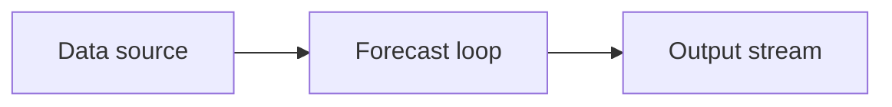
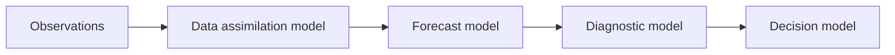

# Overview { #overview_userguide }

Earth2Studio provides composable building blocks for AI weather and climate
inference. Chain models so raw observations can flow through analyses, forecasts,
and application-specific products to support a decision.

Bring your own model at any stage. Start with an existing analysis or forecast,
use an individual component, or assemble a workflow entirely from built-in blocks.
Community and proprietary models can share one pipeline through the same interfaces.

## Building Blocks

Each component has a focused role. Choose the pieces your application needs:

| Component | Role in a workflow |
| --- | --- |
| [Data and metadata](../components/coordinates.md) | Describe what data means. |
| [Data sources](../components/datasources.md) | Fetch fields, forecasts, or observations. |
| [Data assimilation](../components/data_assimilation.md) | Ingest, predict and assimilate sparse observations. |
| [Prognostic models](../components/prognostic.md) | Advance a forecast through time. |
| [Diagnostic models](../components/diagnostic.md) | Derive variables, downscale, or transform fields. |
| [Perturbations](../components/perturbation.md) | Create alternative initial conditions. |
| [Statistics](../components/statistics.md) | Summarize ensembles and evaluate predictions. |
| [IO backends](../components/io.md) | Stream labelled data products to memory or storage. |

Regridding aligns spatial domains between components. Execution tools coordinate
the work, while checkpointing lets supported workflows resume. You can replace a
block with a local implementation without replacing the rest of the pipeline.

## A Basic Forecast Pipeline

1. **Fetch initial conditions.** A data source supplies the fields needed by the
   model, prepared for its variables, history, grid, and device.
2. **Advance the forecast.** The forecast loop initializes a trajectory and steps
   the model forward, producing labelled forecast chunks.
3. **Stream the results.** An IO backend writes each output as it becomes available.
   Downstream components can also transform or score those fields.

## From Observations to Decisions

This basic pipeline can grow increasingly complex as you connect more components.
The goal is to enable AI-driven forecasting pipelines that support real-world
decision-making. A more complete pipeline might look like this:

Build bespoke pipelines using Earth2Studio's selection of open models, your own
custom models, or a combination of both. Bring your own open or proprietary data
through data-source interfaces, including observations, initial conditions, and
existing forecasts. Assemble these components around your application to create a
workflow with its own unique value.

## Constructing Pipelines

Use components directly in Python or assemble them with the execution tools:

- **`Pipeline`** (`earth2studio.run`) manages work items such as initialization times,
  forecast horizons, and ensemble members. It handles output selection, regridding,
  storage, optional scoring, distribution, and resuming completed work.
  `Pipeline.from_model(...)` builds a prognostic runner from a model and data sources,
  with optional diagnostics.
- **`CoupledRunner`** (`earth2studio.coupling`) connects models through `Connector`
  declarations. Connectors describe which producer supplies a consumer's inputs,
  including variable mapping, time selection, and optional regridding. The runner
  schedules components at their own cadences and fetches externally supplied inputs.

Pass a `CoupledRunner` to `Pipeline` to manage a coupled system with the same output
and work-management tools as a single-model forecast.

## Built for People and Agents

Rich metadata makes component inputs and outputs inspectable. An agent can examine
variables, grids, times, and schemas to propose connections and check compatibility
before execution. Data products retain labels and metadata that downstream agents
and applications can use to interpret their results.

Earth2Studio's agentic skills provide workflows for discovering components,
preparing data, running inference, and wrapping custom models. These tools help an
agent build and validate a pipeline against explicit interfaces; your reference
cases establish that a custom model still produces the intended predictions.

## Where To Go Next

- [Install Earth2Studio](install.md) and the model dependencies you need.
- Start with [Data and Metadata](../components/coordinates.md), then explore
  the [core components](../components/index.md).
- Run the [examples](../../examples/index.md) for complete workflows.
- [Wrap your own model](../components/prognostic.md#wrap-your-own-prognostic-model)
  with agent-assisted guidance in your own project.
